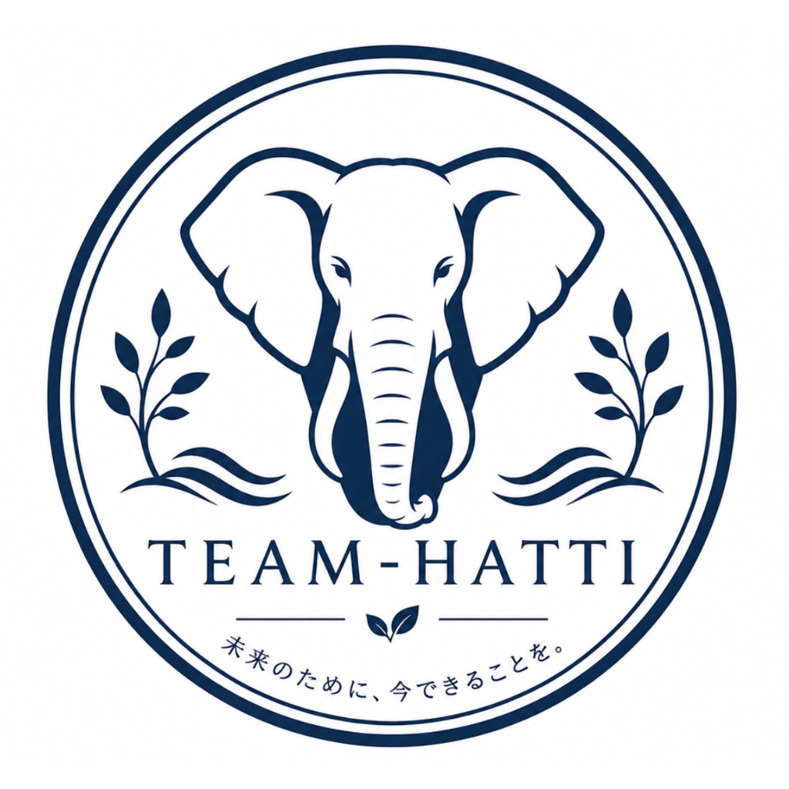

# Team Hatti

**An environmental protection group tackling plastic pollution.**

*हत्ती (Hatti) — Marathi for "elephant": a symbol of memory, strength, and stewardship of the earth.*

---

## About Us

**Team Hatti** is an environment protection group dedicated to reducing plastic waste and understanding its impact on our ecosystems. We combine field research, data analysis, and community awareness to confront one of the most pressing environmental challenges of our time: plastic pollution.

Just as the elephant is known for its long memory and its role as a guardian of its habitat, we aim to remember, protect, and restore the natural environments harmed by plastic waste.

## Our Mission

To reduce plastic trash and develop practical, data-driven methods for detecting, tracking, and mitigating plastic pollution across land, water, and wildlife.

## Research Focus Areas

- **Groundwater Pollution Analysis** — Investigating and analyzing how plastics contaminate groundwater, and developing methods to measure and monitor pollution levels.
- **Fishing Net & Plastic Product Tracking** — Tracking discarded fishing nets ("ghost nets") and other plastic-based products to understand their movement and environmental impact.
- **Plastics in Birds** — Studying the presence and quantity of plastics in birds to assess how plastic pollution travels through and affects wildlife.

## Our Goals

1. Develop accessible tools and techniques to **quantify** plastic pollution in the environment.
2. Build methods to **track** the sources and pathways of plastic waste.
3. Raise **awareness** and share our findings with communities and researchers.
4. Contribute to **actionable solutions** for reducing plastic trash at its source.

## Get Involved

We welcome collaborators, researchers, and volunteers who share our passion for protecting the environment. If you would like to contribute or learn more, please reach out through this repository.

---

*Team Hatti — Protecting our planet, one step at a time.* 🐘🌏

